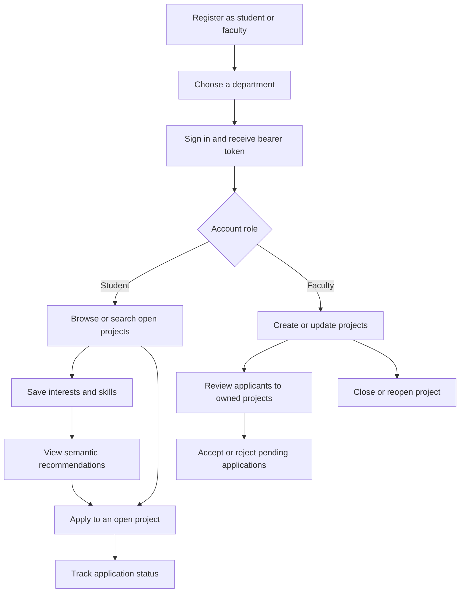
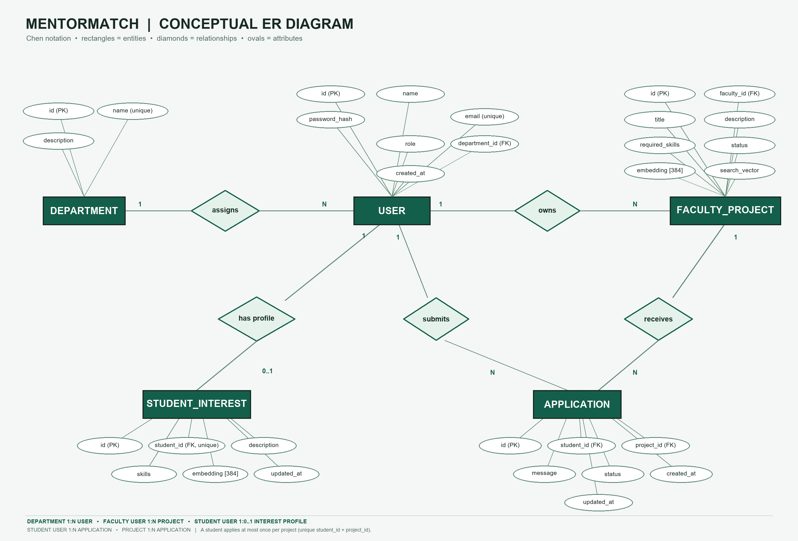
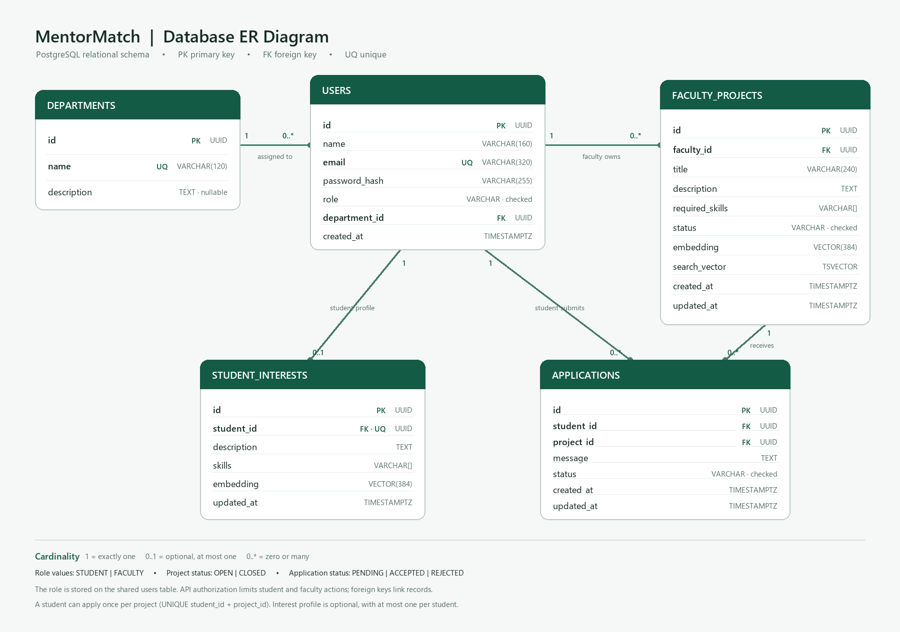

# MentorMatch

MentorMatch connects students with faculty-led research opportunities. This repository contains the verified FastAPI/PostgreSQL backend and a separate Next.js frontend.

## Repository layout

- `backend/` — FastAPI API, SQLAlchemy models, Alembic migrations, tests, database demo guide, and backend environment example.
- `frontend/` — Next.js App Router application for student and faculty workflows.
- `backend/README.md` — complete backend setup, API contract, database architecture, and DBMS demonstration notes.

## Start the backend

Use PostgreSQL with the `pgvector` extension enabled. Configure the backend environment and run these commands in PowerShell from the repository root:

```powershell
Set-Location .\backend
if (-not (Test-Path .env)) { Copy-Item .env.example .env }
# Edit .env locally: configure DATABASE_URL and a private JWT_SECRET_KEY (at least 32 characters).
py -m venv .venv
.\.venv\Scripts\Activate.ps1
python -m pip install -r requirements-dev.txt
alembic upgrade head
python -m uvicorn app.main:app --reload
```

The database must be running and ready before migrations. Departments are provisioned administratively; registration cannot proceed until at least one department exists. The backend's default browser CORS origin includes `http://localhost:3000`. See [backend/README.md](backend/README.md) for PostgreSQL/pgvector details, embedding setup, endpoint contracts, test instructions, and safe DBMS demonstrations.

## Start the frontend

In a second PowerShell terminal, from the repository root:

```powershell
Set-Location .\frontend
Copy-Item .env.example .env.local
npm install
npm run dev
```

Open `http://localhost:3000`. The frontend API base defaults to `http://127.0.0.1:8000/api/v1`; set `NEXT_PUBLIC_API_BASE_URL` in `frontend/.env.local` if the backend uses another origin. Add the frontend's exact origin to the backend `CORS_ORIGINS` setting if it is not `http://localhost:3000`.

## Workflows

- Students register with a department, sign in, browse or search open faculty projects, create an interest profile, get semantic recommendations, apply with a message, and track each application status.
- Faculty register with a department, sign in, create and edit projects, close or reopen their projects, review applications to their own projects, and accept or reject pending applications.
- The frontend calls the FastAPI service over HTTP. The API authenticates protected requests with bearer tokens and reads or writes PostgreSQL through SQLAlchemy. The browser never connects directly to PostgreSQL.

## Application workflow



### Student flow

1. **Register and sign in.** The student submits a name, unique email, password, role, and department. The API hashes the password and returns a bearer token after login.
2. **Discover projects.** Browse open projects or search by keywords. Project search uses PostgreSQL full-text search over titles, descriptions, and skills.
3. **Create an interest profile.** Save a description and skills. The API generates a 384-dimensional embedding for semantic matching.
4. **Get recommendations.** The API compares the student's interest embedding with open project embeddings using cosine distance and returns the closest matches.
5. **Apply and track.** Submit a message to an open project. A student may apply only once to each project and can view their own application statuses.

### Faculty flow

1. **Register and sign in** with the faculty role and a department.
2. **Publish opportunities.** Create projects with a title, description, and required skills. The API prepares search and semantic-matching data for each project.
3. **Manage projects.** Edit or close/reopen projects owned by the signed-in faculty member. Projects are closed rather than deleted so application history remains intact.
4. **Review applications.** View applicants only for projects owned by that faculty member. Pending applications can be accepted or rejected; a final decision cannot be changed through the current API.

## Relational database schema

MentorMatch uses a normalized relational schema in PostgreSQL. In this two-dimensional table model, each table stores one kind of entity, each row is one record, and each column stores one attribute. UUID primary keys identify records; foreign keys connect related records.

#### Chen ER diagram



The Chen diagram uses rectangles for entities, diamonds for relationships, and ovals for attributes. `USER.role` distinguishes students and faculty; the conceptual relationships and cardinalities are shown directly.

#### Relational schema diagram



The relational diagram shows all five tables, their columns, primary and foreign keys, key PostgreSQL data types, and relationship cardinalities.

### Tables and relationships

| Table | Purpose and important fields |
| --- | --- |
| `departments` | Department lookup: `id` (primary key), unique `name`, optional `description`. Departments are provisioned administratively and read through the API. |
| `users` | Shared account table for both roles. `role` is `STUDENT` or `FACULTY`; `department_id` references `departments`; `email` is unique; `password_hash` stores a one-way password hash, never the raw password. |
| `faculty_projects` | Research opportunities owned by faculty through `faculty_id`. Stores title, description, required skill array, `OPEN`/`CLOSED` status, a 384-value semantic embedding, and a full-text `search_vector`. |
| `student_interests` | A student's description, skills, and semantic embedding. `student_id` is unique, so each student can have at most one profile. The profile is removed if its student account is deleted. |
| `applications` | A student's message and status for a project. `student_id` and `project_id` reference the applicant and opportunity. A unique constraint on that pair prevents duplicate applications. Status is `PENDING`, `ACCEPTED`, or `REJECTED`. |

`users` is intentionally shared by students and faculty; there are no separate student and faculty account tables. The role determines which operations an account may perform. One department can have many users, one faculty member can own many projects, one student can have zero or one interest profile and many applications, and one project can receive many applications.

Foreign-key restrictions preserve department, project, and application history. A student's interest profile cascades with the student account. Database checks constrain roles and statuses, while API authorization ensures faculty can only manage their own projects and applications.

### Search and recommendation data

- `faculty_projects.search_vector` is maintained for PostgreSQL full-text keyword search; a GIN index supports matching titles, descriptions, and skills.
- `faculty_projects.embedding` and `student_interests.embedding` store 384-dimensional vectors from the same sentence-transformer model. IVFFlat cosine indexes support semantic recommendations.
- Triggers maintain the project search vector and update timestamps. The schema also defines the `open_projects_with_application_stats` view and the `match_open_projects` database function.
- `required_skills` and `skills` are PostgreSQL string arrays, keeping each skill list with its owning project or interest profile.

The checked-in demo accounts and records are synthetic. Do not use them as real student, faculty, or research data.

The backend currently returns a maximum of 100 projects per list request. Its project details do not include faculty name/department, and application records include student IDs rather than student profile details. It also has no account-edit, refresh-token, or session-revocation endpoints. The UI documents those limits and does not invent the missing fields.

## Verification

From `backend/`, run `python -m pytest -q` against a configured test database. From `frontend/`, run:

```powershell
npm run typecheck
npm run lint
npm run build
```

Then start both services and exercise student and faculty workflows against the configured API. Test results depend on the installed dependencies, PostgreSQL/pgvector service, department data, and (for semantic writes/recommendations) the backend embedding model.
